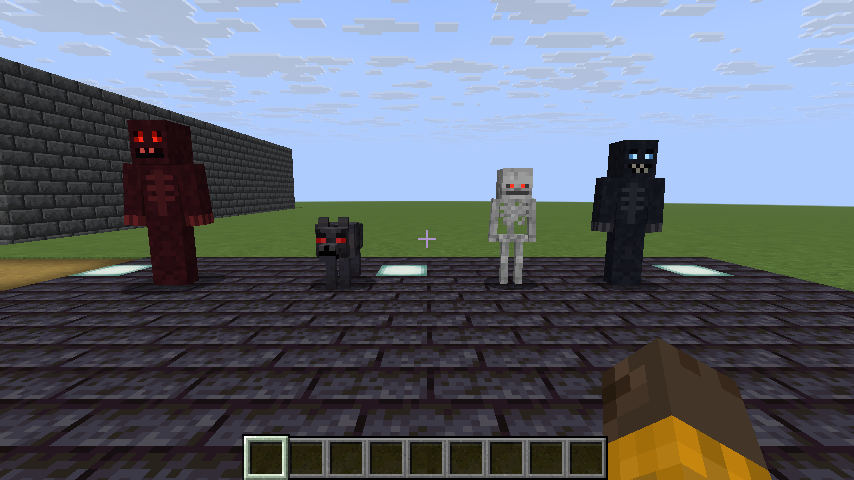

<div align="center">

# 🧠 Sentience

**AI that truly perceives the world, for your Minecraft mods.**

A Fabric library inspired by Unreal Engine's AI tools: realistic multi-sense perception,
memory, Blackboard, alert levels and ready-to-use behaviours.

[](https://github.com/Ananasloll3/Sentience/actions/workflows/build.yml)
[](https://ananasloll3.github.io/Sentience/en/)


[](LICENSE)

[**📖 Documentation**](https://ananasloll3.github.io/Sentience/en/) ([Français](https://ananasloll3.github.io/Sentience/) · [中文](https://ananasloll3.github.io/Sentience/zh/)) ·
[Quick start](https://ananasloll3.github.io/Sentience/en/demarrage/premier-agent/) ·
[Demo mod](https://ananasloll3.github.io/Sentience/en/demo/) ·
[Releases](https://github.com/Ananasloll3/Sentience/releases)



</div>

## Why Sentience?

Vanilla mobs spot you through walls and charge straight at you. With Sentience, a creature
**never knows your real position**: it hears a noise, guesses where it came from, goes to check,
searches, tracks you… and can be wrong. You can hide, stay quiet, sneak, use the rain,
break your trail by crossing a river.

| | |
|---|---|
| 👂 **Physical hearing** | Every game sound, propagated with attenuation, walls, materials and background noise. Players' **voice** through Simple Voice Chat. |
| 👁 **Believable sight** | Vision cone, blurry periphery, darkness, sneaking, camouflage, progressive detection meter. |
| 👃 **Smell** | Trails that water breaks and rain washes away; blood attracts; scent doesn't go through walls. |
| ⚔ **Pain & touch** | Being hit or brushed against reveals your position. |
| 📣 **Communication** | Agents share what they know. |
| 🧠 **Memory & alert** | Perception fusion, uncertainty, forgetting; suspicious → investigate → hunt. |
| 🎛 **Per-mod rules** | Each mod tunes the physics of perception for its own mobs, without conflicts. |
| 🧩 **Extensible** | Custom senses, components, noises, scents and camouflage. |
| ⚡ **Fast** | Automatic level of detail, expensive work only when it matters. |

## In ten lines

```java
@Override
protected void initGoals() {
    Agent agent = Agent.builder(this)
            .hearing(HearingProfile.KEEN)        // hearing + microphone
            .sight(SightConfig.nocturnal())      // sight
            .scent(ScentSense.hound())           // smell
            .damage().touch()                    // pain, touch
            .awareness(AwarenessProfile.DEFAULT) // suspicious → investigate → hunt
            .defaultGoals(2, 0.9, 1.4)           // listen, investigate, search, hunt
            .build();
}
```

A vanilla mob or another mod's mob, without touching its code:

```java
AgentTemplates.register(EntityType.ZOMBIE, agent -> agent
        .hearing(HearingProfile.DEFAULT)
        .sight(SightConfig.humanoid())
        .defaultGoals(3, 1.0, 1.2));
```

## Installation

Through [Cursemaven](https://cursemaven.com) or the [Modrinth Maven](https://support.modrinth.com/en/articles/8801191-modrinth-maven)
once Sentience is published on these platforms, or from source:

```bash
git clone https://github.com/Ananasloll3/Sentience.git && cd Sentience
./gradlew publishToMavenLocal
```

```groovy
repositories { mavenLocal() }
dependencies { modImplementation "com.ananasloll3:sentience:0.1.0" }
```

Details: [installation](https://ananasloll3.github.io/Sentience/en/demarrage/installation/).

Minecraft **1.21.10**, Fabric Loader **0.17.3+**, Fabric API, Java 21.
[Simple Voice Chat](https://modrinth.com/plugin/simple-voice-chat) is optional.

➡️ Everything else is in the [**documentation**](https://ananasloll3.github.io/Sentience/en/).

## Demo mod

```bash
./gradlew runTestmodClient
```

Four creatures, each focused on one sense — the **Stalker** (blind), the **Sentinel** (deaf),
the **Hound** (smell) and the **Abomination** (everything at once) — plus improved vanilla zombies,
and a test arena map available in the [releases](https://github.com/Ananasloll3/Sentience/releases).
`/sentience debug` shows what each creature is thinking.

## Development

| Command | Effect |
|---|---|
| `./gradlew build` | builds the library and the demo mod |
| `./gradlew runTestmodClient` | launches the game with the demo mod |
| `./gradlew publishToMavenLocal` | publishes to your local Maven |
| `pip install mkdocs-material mkdocs-static-i18n && mkdocs serve` | local documentation |

```
src/main      the library (api/ public and stable, impl/ internal)
src/testmod   the demo mod, never published
docs/         the documentation (MkDocs Material, FR / EN / 中文)
```

## Roadmap

- [x] Agent, Blackboard, level of detail, debug
- [x] Hearing, voice, sight, smell, pain, touch, communication
- [x] Per-mod rules
- [ ] Behavior Trees in JSON
- [ ] Navigation v2 (async A*, doors, ladders, jumps)
- [ ] EQS, squads, Director

## License

[MIT](LICENSE) — use Sentience in your mods, open source or not.
