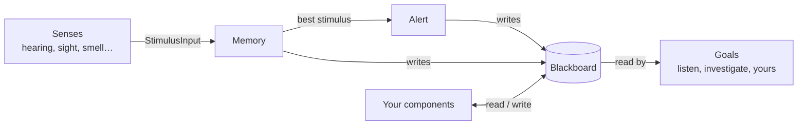

# The agent

An `Agent` groups a [Blackboard](blackboard.md) and a list of **components** (`AgentComponent`).
The built-in components are **perception** (the senses + their memory) and **alert**;
you can add your own.



## The builder

| Method | Effect |
|---|---|
| `.rules(SentienceRules)` | Your mod's perception rules ([guide](../guides/regles.md)) |
| `.hearing(HearingProfile[, interest])` | [Hearing](../sens/ouie.md) |
| `.sight(SightConfig)` | [Sight](../sens/vue.md) |
| `.scent(ScentSense)` | [Smell](../sens/odorat.md) |
| `.damage()` / `.touch([targets])` | [Pain, touch](../sens/douleur-toucher.md) |
| `.sense(SenseModule)` | [Custom sense](../guides/sens-custom.md) |
| `.memory(capacity, ticks)` | Memory size and duration (8 memories, 600 ticks) |
| `.awareness(AwarenessProfile)` / `.noAwareness()` | [Alert levels](alerte.md) |
| `.defaultGoals(priority, walk, run)` | Ready-to-use behaviours |
| `.searchDuration(ticks)` | Search duration before giving up (240) |
| `.component(AgentComponent)` | [Custom component](../guides/composant-custom.md) |
| `.build()` | Creates the agent and attaches it to the mob |

## Lifecycle

| Moment | What happens |
|---|---|
| `build()` | `onAttach` on each component |
| The mob spawns / its chunk loads | `onLoad`: senses register themselves (e.g. with the hearing system) |
| Every server tick | `tick(agent, world, deltaTicks)`, before the vanilla AI |
| Death / unload | `onUnload` |

## Level of detail (LOD)

An agent far from every player thinks less often:

| Distance to the nearest player | Thinking |
|---|---|
| ≤ 32 blocks | every tick |
| ≤ 64 blocks | 1 tick in 2 |
| ≤ 128 blocks | 1 tick in 5 |
| beyond | 1 tick in 20 |

`deltaTicks` tells how many ticks have passed since the last think.
Any new perception forces a reaction on the next tick: a distant mob that hears an explosion
reacts immediately.

## Events

```java
agent.onStimulus((agent, stimulus) -> { ... });               // every perception
agent.onAwarenessChanged((agent, from, to) -> { ... });       // alert change
```

## Access

```java
Agent agent = Agent.of(entity);                 // null if the entity has no agent
agent.mob(); agent.rules(); agent.blackboard();
agent.perception();                             // senses + memory
agent.awareness();                              // alert level
agent.find(MyComponent.class);                  // a specific component
agent.thinkInterval();                          // current LOD
```
