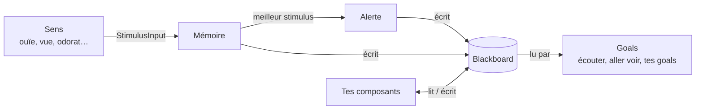

# L'agent

Un `Agent` regroupe un [Blackboard](blackboard.md) et une liste de **composants** (`AgentComponent`).
Les composants intégrés sont la **perception** (les sens + leur mémoire) et l'**alerte** ;
tu peux ajouter les tiens.



## Le builder

| Méthode | Effet |
|---|---|
| `.rules(SentienceRules)` | Règles de perception de ton mod ([guide](../guides/regles.md)) |
| `.hearing(HearingProfile[, intérêt])` | [Ouïe](../sens/ouie.md) |
| `.sight(SightConfig)` | [Vue](../sens/vue.md) |
| `.scent(ScentSense)` | [Odorat](../sens/odorat.md) |
| `.damage()` / `.touch([cibles])` | [Douleur, toucher](../sens/douleur-toucher.md) |
| `.sense(SenseModule)` | [Sens personnalisé](../guides/sens-custom.md) |
| `.memory(capacité, ticks)` | Taille et durée de la mémoire (8 souvenirs, 600 ticks) |
| `.awareness(AwarenessProfile)` / `.noAwareness()` | [Niveaux d'alerte](alerte.md) |
| `.defaultGoals(priorité, marche, course)` | Comportements prêts à l'emploi |
| `.searchDuration(ticks)` | Durée de fouille avant abandon (240) |
| `.component(AgentComponent)` | [Composant personnalisé](../guides/composant-custom.md) |
| `.build()` | Crée l'agent et l'attache au mob |

## Cycle de vie

| Moment | Ce qui se passe |
|---|---|
| `build()` | `onAttach` sur chaque composant |
| Le mob apparaît / son chunk se charge | `onLoad` : les sens s'enregistrent (ex. auprès du système d'ouïe) |
| Chaque tick serveur | `tick(agent, world, deltaTicks)`, avant l'IA vanilla |
| Mort / déchargement | `onUnload` |

## Niveau de détail (LOD)

Un agent loin de tout joueur réfléchit moins souvent :

| Distance au joueur le plus proche | Réflexion |
|---|---|
| ≤ 32 blocs | chaque tick |
| ≤ 64 blocs | 1 tick sur 2 |
| ≤ 128 blocs | 1 tick sur 5 |
| au-delà | 1 tick sur 20 |

`deltaTicks` indique combien de ticks se sont écoulés depuis la dernière réflexion.
Toute nouvelle perception force une réaction au tick suivant : un mob lointain qui entend une explosion
réagit immédiatement.

## Événements

```java
agent.onStimulus((agent, stimulus) -> { ... });               // chaque perception
agent.onAwarenessChanged((agent, from, to) -> { ... });       // changement d'alerte
```

## Accès

```java
Agent agent = Agent.of(entity);                 // null si l'entité n'a pas d'agent
agent.mob(); agent.rules(); agent.blackboard();
agent.perception();                             // sens + mémoire
agent.awareness();                              // niveau d'alerte
agent.find(MonComposant.class);                 // un composant précis
agent.thinkInterval();                          // LOD actuel
```
